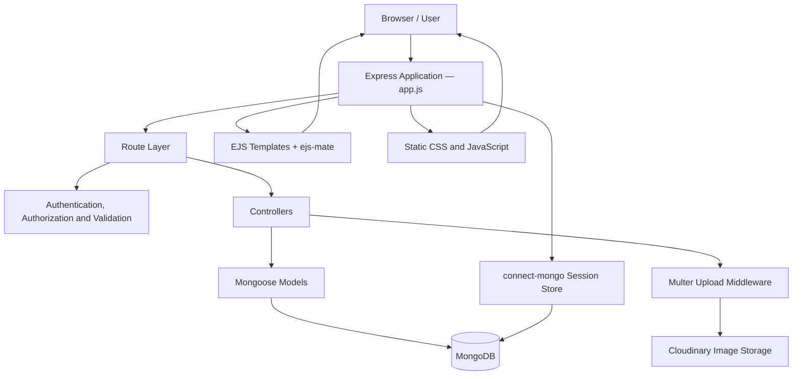
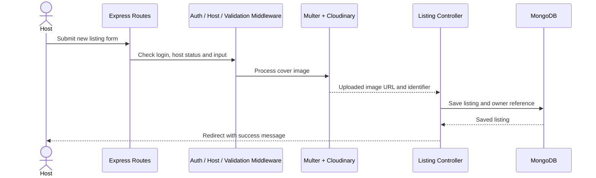

# VegaBond — Stay Somewhere With a Story

A full-stack vacation-stay discovery and property-listing web application built with **Node.js, Express, MongoDB, and EJS**.

VegaBond lets visitors browse stay listings, view property details, and read reviews. Registered users can become hosts, upload property images, and manage their own listings. The application uses server-rendered pages, session-based authentication, MongoDB persistence, and Cloudinary for image storage.

> **Project scope:** The current codebase focuses on listing discovery, host-managed listings, user authentication, and reviews. Reservation booking, checkout, and payment processing are not implemented in the supplied code.

---

## Project Overview

VegaBond is organized as an Express application with separate route, controller, model, middleware, utility, and view layers. EJS templates render the interface on the server, while MongoDB stores users, listings, reviews, and sessions.

### Key Capabilities

- Browse property listings and open individual listing pages.
- Display listing information such as title, description, location, country, category, cover image, and nightly price.
- Register and log in with username/password authentication.
- Become a host to unlock listing management routes.
- Create listings with image uploads stored through Cloudinary.
- Edit or delete listings subject to host and ownership checks.
- Add reviews with a rating from 1 to 5 and a comment.
- Delete reviews as their author.
- Validate listing and review input with Joi.
- Display success and error messages using flash messages.
- Persist login sessions in MongoDB.
- Use a responsive, server-rendered interface styled with Bootstrap and custom CSS.

---

## Application Areas

### Listing Discovery

The listings interface provides a card-based overview of stays, including property images, location, category, and nightly price. Visitors can open a listing to see its details and associated reviews. The listing page also contains category and sorting controls; see [Known Issues and Notes](#known-issues-and-notes) for current controller/template mismatches affecting some controls.

### Host Listing Management

Authenticated users can opt into host status. Hosts can create a listing by providing a title, description, location, country, price, category, and cover image. Listing edit and delete routes include ownership checks so hosts can manage their own properties rather than another host's listing.

### Reviews

Signed-in users can submit a rating and written comment for a listing. Ratings are validated to the range of 1–5. Review documents reference their author, and the listing stores references to its reviews.

### Authentication and Sessions

Passport Local and `passport-local-mongoose` handle username/password authentication. Express sessions are stored in MongoDB with `connect-mongo`, and `connect-flash` provides feedback messages after user actions.

---

## System Architecture



The application follows a layered structure:

- **Routes** map HTTP requests to middleware and controller methods.
- **Middleware** handles authentication, host permissions, ownership checks, and input validation.
- **Controllers** coordinate request handling and database operations.
- **Models** define the Mongoose schemas for users, listings, and reviews.
- **Views** render HTML using EJS and the shared `ejs-mate` layout.
- **External storage** uses Cloudinary for uploaded listing images.

---

## Listing Creation Workflow



---

## Technology Stack

### Backend

- **Node.js** — JavaScript runtime (repository specifies Node.js `22.17.0`)
- **Express 4** — HTTP server and routing
- **MongoDB** — document database
- **Mongoose** — schema definitions and database queries
- **Passport.js** — local authentication strategy
- **passport-local-mongoose** — user authentication helpers
- **express-session** and **connect-mongo** — persistent sessions
- **connect-flash** — one-time user feedback messages
- **Joi** — request-data validation
- **Multer** and **multer-storage-cloudinary** — file upload handling
- **Cloudinary** — listing image storage
- **method-override** — PUT and DELETE actions from HTML forms

### Frontend

- **EJS** — server-side templates
- **ejs-mate** — reusable layouts and template composition
- **Bootstrap 5** — layout and responsive components
- **Custom CSS** — application styling and responsive adjustments
- **Vanilla JavaScript** — client-side interactions

---

## Routes

The primary routes mounted by `app.js` are summarized below.

### Listings — `/listings`

| Method | Path | Purpose | Access |
|---|---|---|---|
| `GET` | `/listings` | Browse listings | Public |
| `GET` | `/listings/new` | Render the new-listing form | Signed-in host |
| `POST` | `/listings` | Create a listing and upload its image | Signed-in host |
| `GET` | `/listings/:id` | View listing details and reviews | Public |
| `GET` | `/listings/:id/edit` | Render the edit form | Owner host |
| `PUT` | `/listings/:id` | Update listing details | Owner host |
| `DELETE` | `/listings/:id` | Delete a listing | Owner host |

### Reviews — `/listings/:id/reviews`

| Method | Path | Purpose | Access |
|---|---|---|---|
| `POST` | `/listings/:id/reviews` | Add a review to a listing | Signed-in user |
| `DELETE` | `/listings/:id/reviews/:reviewId` | Delete a review | Review author |

### Users and Host Onboarding

| Method | Path | Purpose | Access |
|---|---|---|---|
| `GET` / `POST` | `/signup` | Render registration form / register a user | Public |
| `GET` / `POST` | `/login` | Render login form / authenticate | Public |
| `GET` | `/become-host` | Render host onboarding page | Signed-in user |
| `POST` | `/become-host` | Enable host status | Signed-in user |
| `GET` | `/logout` | Log out the current user | Signed-in session |

`PUT` and `DELETE` requests submitted from HTML forms are supported through `method-override`.

---

## Repository Structure

```text
happymite-project-a/
├── app.js                       # Express app setup, sessions, Passport and error handling
├── cloudconfig.js               # Cloudinary configuration and upload storage
├── package.json                 # Dependencies and npm scripts
├── schema.js                    # Joi listing and review validation schemas
├── controllers/
│   ├── listing.js                # Listing operations
│   ├── review.js                 # Review operations
│   └── user.js                   # Registration, login redirect, host status and logout
├── init/
│   ├── data.js                   # Example listing data
│   └── index.js                  # Database initialization script
├── middlewares/
│   ├── middleware.js             # Authentication, ownership and validation middleware
│   └── uploads.js                # Multer upload configuration
├── models/
│   ├── listing.js                # Listing schema and review cleanup hook
│   ├── review.js                 # Review schema
│   └── user.js                   # User schema and Passport plugin
├── public/
│   ├── css/style.css             # Main application styles
│   └── css/js/script.js          # Client-side JavaScript asset
├── routes/
│   ├── listing.js                # Listing endpoints
│   ├── review.js                 # Review endpoints
│   └── user.js                   # User and host endpoints
├── utils/
│   ├── ExpressError.js           # Custom HTTP error class
│   └── wrapAsync.js               # Async route error wrapper
└── views/
    ├── error.ejs                 # Error page
    ├── includes/                  # Navbar, flash messages and footer
    ├── layouts/boilerplate.ejs   # Shared page layout
    ├── listings/                  # Index, show, new and edit pages
    └── users/                     # Signup, login and host onboarding pages
```

---

## Getting Started

### Prerequisites

Before running VegaBond locally, install or configure:

- Node.js `22.17.0` (or a compatible Node.js 22 release)
- npm
- A MongoDB database, either MongoDB Atlas or a local MongoDB server
- A Cloudinary account for listing image uploads

### 1. Clone the Repository

```bash
git clone <your-repository-url>
cd happymite-project-a
```

Replace `<your-repository-url>` with the URL of your Git repository.

### 2. Install Dependencies

```bash
npm install
```


### 3. Initialize Example Listings (Optional)

The repository includes example stay data in `init/data.js`. To insert it into the configured database, run:

```bash
node init/index.js
```

The script skips insertion when listing documents already exist. To delete the existing listing documents and replace them with the sample data, run:

```bash
node init/index.js --reset
```

> **Destructive operation:** `--reset` deletes existing listing documents in the selected database. Use it only with a development database whose data can be discarded.

### 4. Start the Application

```bash
npm start
```

Open [http://localhost:9080/listings](http://localhost:9080/listings) in your browser. If `PORT` is set, the application uses that port instead.

For development with automatic restarts, run:

```bash
npx nodemon app.js
```

---

## Environment Variables

| Variable | Required | Description |
|---|---|---|
| `ATLAS_URL` | Yes | MongoDB connection string used by the application |
| `SESSION_SECRET` | Yes | Secret used by Express sessions and the MongoDB session store configuration |
| `CLOUD_NAME` | Yes for image uploads | Cloudinary cloud name |
| `CLOUD_API_KEY` | Yes for image uploads | Cloudinary API key |
| `CLOUD_API_SECRET` | Yes for image uploads | Cloudinary API secret |
| `PORT` | No | HTTP port; defaults to `9080` |
| `NODE_ENV` | No | Environment mode; dotenv is loaded by the app outside production |

Keep secrets out of source control and use your deployment provider's environment-variable settings in hosted environments.

---

## Database Models

### User

Stores the user's email and host status. The `passport-local-mongoose` plugin provides the username/password authentication fields and methods.

### Listing

Stores the title, description, image metadata, nightly price, location, country, category, owner reference, and review references. Mongoose timestamps are enabled.

### Review

Stores the comment, rating, creation date, and author reference. The rating is constrained to the range 1–5 in the Mongoose schema and validated by Joi on submission.

---

## Validation and Access Control

The project includes middleware for:

- Requiring a signed-in user for protected actions.
- Requiring host status for listing creation and management.
- Checking listing ownership before editing or deleting a listing.
- Checking review authorship before deleting a review.
- Validating listing and review request bodies with Joi.
- Wrapping asynchronous route handlers so errors are forwarded to Express error handling.
- Rendering a custom 404 response and a shared error page for application errors.

These controls are implemented in the existing application code; review the [Known Issues and Notes](#known-issues-and-notes) section before treating the app as production-ready.

---

## NPM Scripts

| Command | Description |
|---|---|
| `npm start` | Starts the Express app with `node app.js` |
| `npx nodemon app.js` | Runs the app with automatic restarts during development |
| `npm test` | Placeholder script; automated tests are not configured yet |

---

## Known Issues and Notes

The README describes the supplied repository, including areas that should be reconciled before deployment:

- **Listing search and sorting:** `controllers/listing.js` defines `module.exports.index` twice, so the second definition replaces the earlier search implementation. The view and controller also use different values for some sorting options. Align the controller and view query parameters before relying on search and all sorting modes.
- **Category validation:** The Joi category schema includes `other`, while the Mongoose listing enum does not. Make the accepted category values consistent to avoid validation conflicts.
- **Logout method:** Logout is currently exposed as a `GET` route. Prefer a `POST` route for state-changing logout actions and update the UI form/link accordingly.
- **Automated tests:** The `test` script is currently a placeholder and exits with an error; test coverage has not been configured.
- **Environment setup:** The app reads `ATLAS_URL` and `SESSION_SECRET` when it starts. Configure them before launching the app, and configure Cloudinary credentials before creating listings with images.
- **Bookings and payments:** The current repository does not include a reservation workflow, availability calendar, checkout, or payment integration.

---


## Contributing

1. Fork the repository or create a feature branch.
2. Keep routes, controllers, models, and views separated according to the existing structure.
3. Validate and authorize all state-changing requests on the server.
4. Test affected routes locally before opening a pull request.
5. Never include API keys, database credentials, session secrets, or user data in commits.

---

## License

The `package.json` declares the project license as **ISC**. Review the repository's license requirements and include a `LICENSE` file if it is intended to be distributed under that license.

---

## Ownership 
Copyright © 2026 MD RAQUIF. All rights reserved.

The complete implementation is proprietary and privately maintained.
